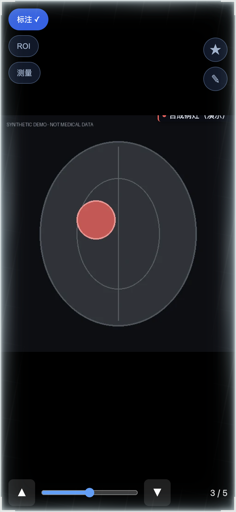

# 影像解剖图谱查看器

个人自用的影像解剖 / 病例查看器前端，从项目中抽出的可运行演示版。手机优先，纯 HTML/CSS/JS，无框架。

关键词：影像解剖图谱、医学影像查看器、CT/MRI 切片、DICOM、SVG 标注、ROI 测量、PWA。



## 功能

- 多层切片翻页：滑块、上下按钮、滚轮、键盘
- 双指缩放、拖动、双击复位
- SVG 轮廓标注与结构名（点选高亮）
- ROI 矩形 / 椭圆测值（均值、标准差、面积）
- 长度 / 角度测量
- 收藏 / 最近 / 笔记（本地 `localStorage`，不上传）
- 响应式布局，适配手机 WebView 和浏览器

## 在线演示

https://y89442459-maker.github.io/anatomy-atlas-viewer/

`docs/` 是 **5 层合成演示病例**，图上标了 `SYNTHETIC DEMO - NOT MEDICAL DATA`，不是真实医学影像。

本地运行：

```bash
cd docs
python3 -m http.server 8765
# 打开 http://127.0.0.1:8765/
```

## 数据格式

```text
case/
├── meta.json       # { z, w, h, structures: [{id, name_en, name_zh, color}], cover_k }
├── contours.json   # { slices: { "层号": [{ s: 结构id, p: [归一化 x1,y1,...] }] } }
├── slices/         # 0000.webp, 0001.webp, ...
└── info.json       # 可选：病例信息/科普
```

## 目录

```text
src/viewer/        查看器源码（index.html / style.css / viewer.js / person-store.js）
docs/              合成演示病例（自包含，GitHub Pages 从 /docs 发布）
```

## 说明

这个仓库只包含查看器代码和合成演示数据，**不包含 e-Anatomy 内容、真实病例、服务器配置或密钥**。真实病例请使用你有权使用的数据（如 TCIA、IDC 等公开数据集或本院数据），并遵守其许可与隐私要求。
